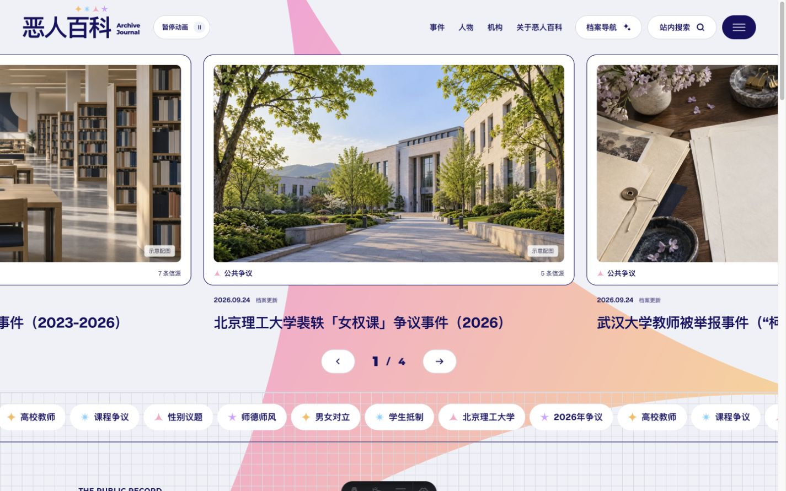
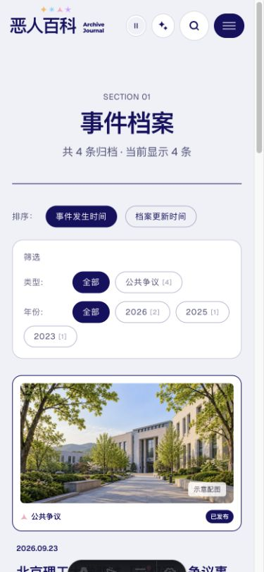
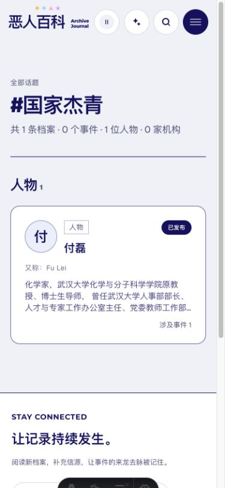
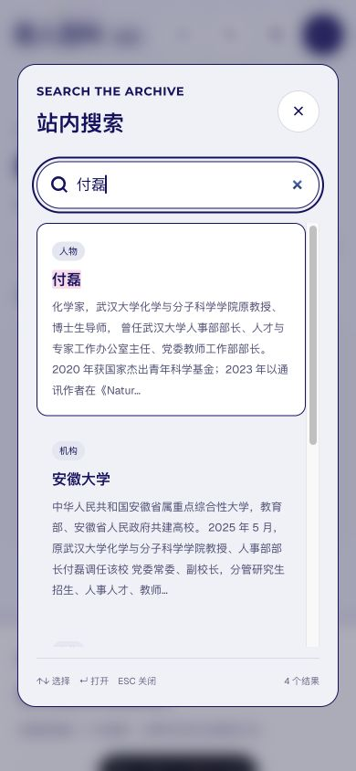
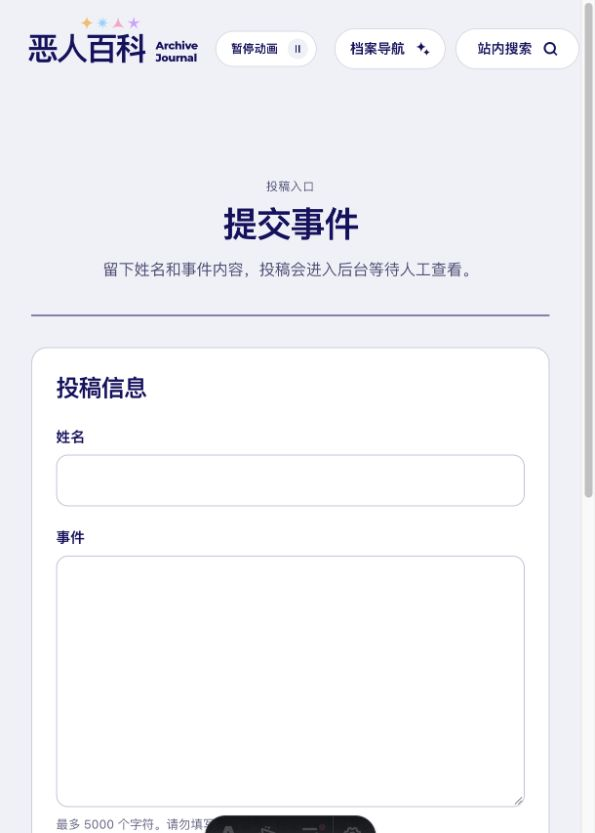
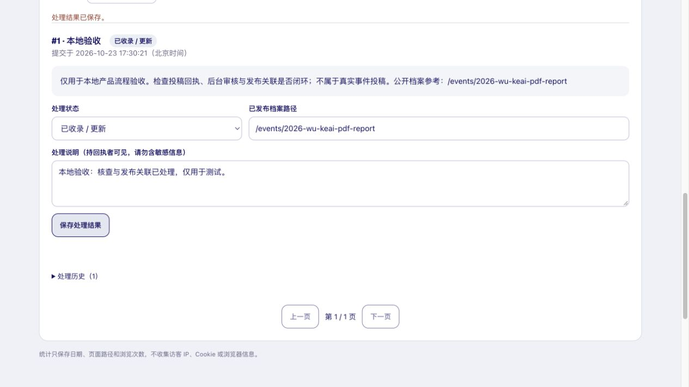
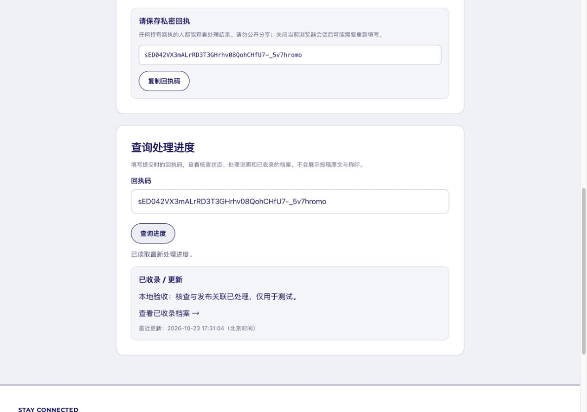

# 产品逻辑、闭环与界面审核 · 2026-10-23

本轮检查并修复了现有项目的主要用户流程，保留 Journal 视觉方向及工作区既有内容。代码、构建和本地浏览器验收已完成；没有部署到生产，也没有修改生产数据库。

## 用户目标与范围

读者能从事件、人物、机构或话题找到档案，理解时间线和信源，收藏后再次找到内容；发现问题时能提交材料，并查到人工处理结果。维护者能处理所有投稿，保留处理历史，并把结果关联到实际公开的档案。

审核覆盖首页、三类列表与详情、话题、搜索、收藏、更正、投稿、管理后台、编辑脚手架、发布边界和响应式样式。现有事实/主张分区、信源、示意图说明和原生对话框是可保留的基础。

## 已修复问题

| 优先级 | 原问题 | 修复结果 |
| --- | --- | --- |
| 高 | 投稿只有入库和最近 50 条列表，没有处理闭环 | 私密回执查询；状态、处理说明、分页、发布关联及历史记录 |
| 高 | 后台成功读取后没有渲染队列 | 修复渲染调用，并用真实本地 D1 从投稿到查询走通 |
| 高 | 人物/机构的 33 处独有标签链接没有对应页面 | 话题统一覆盖三类公开档案；归档独有标签不生成死链 |
| 高 | 双向关系只读取一边，漏关联与计数不一致 | 统一关系合并函数，保留显式顺序与公开状态边界 |
| 高 | 新条目工具会覆盖同名文件，且模板不满足 schema | 独占创建，重复 ID 拒绝覆盖；生成合法草稿 |
| 中 | 网络重试可能重复投稿，成功与失败反馈不完整 | 同回执幂等；失败保留原文；只在确认入库后显示成功 |
| 中 | 后台刷新丢失未保存审核说明，并发可能覆盖结果 | 内存草稿、离页提示、版本冲突保护；成功退出清理数据 |
| 中 | “已收录”可以成为无效链接 | 服务端检查公开发布索引；撤回后回执隐藏失效链接 |
| 中 | 筛选使用 replaceState，后退不能恢复筛选 | pushState、动态链接、多条件保留、清空入口与结果播报 |
| 中 | 搜索名字无法召回显式关联事件 | 索引补入公开关联人物、机构的名称和别名 |
| 中 | 收藏数据异常、撤回后空白、写失败误报 | 数据归一化、单项移除、失效说明、错误反馈与跨标签同步 |
| 中 | 相关事件出现嵌套链接 | 拆分主链接和实体链接，完整构建检查无嵌套锚点 |
| 中 | 窄屏导航横向溢出 | 断点分配文字/图标导航，320–1440px 八档无溢出 |
| 中 | 搜索无重试、IME 回车误跳、Escape 先清空输入 | 加载/超时/重试，组合输入保护，显式关闭和焦点返回 |
| 中 | 二维码接口实际 404；复制失败仍提示成功 | 移除失效二维码，保留其他分享途径；失败支持手动复制 |
| 中 | 更正承诺回信却不收联系方式 | 改为凭私密回执查询；申诉入口统一且携带条目上下文 |
| 中 | 中立定位与“耻辱柱”等产品文案矛盾 | 关于页及声明改为可核查的公共记录，不改写事件事实 |
| 中 | 时间线描述原样注入 HTML | 普通文字由 Astro 转义，仅显式信源编号生成链接；信源限定 HTTP(S) |
| 中 | 本地 Astro 无 API，无法完整验收 | 增加 `npm run dev:full`，隔离 D1、凭证、配置与迁移 |
| 低 | Cloudflare 静态缓存规则含 6 个无效路径规则 | 按实际资源目录配置；未版本化资源不再缓存一年 |
| 低 | 后台、收藏等辅助页面进入 sitemap | 从 sitemap 排除非内容页与发布检查索引 |

## 流程证据

截图均来自本轮本地浏览器，测试投稿是合成数据，不属于真实事件。回执截图中的回执只对应隔离测试库。

1. **进入与查找。** 原首页在约 595px 的面板内挤掉导航菜单。修复后检查 320、390、595、601、800、960、1100、1440px；保持现有卡片与主题图，不进行风格重设计。

   

   

2. **筛选与回退。** 年份筛选可得到 1 条结果；切换更新时间保留年份；后退逐步恢复排序、再恢复全部 4 条。清除筛选可见，链接使用 `aria-current`。

   

3. **人物、话题与搜索。** 原本没有页面的“国家杰青”话题可返回人物及事件计数。搜索能通过公开人物姓名召回相关事件。阻断搜索索引请求时出现重试入口，解除阻断后原地恢复；Escape 关闭并把焦点还给搜索按钮。

   

   

4. **投稿与处理。** 原投稿页只有两项输入与一句成功提示。现在明确称呼用途、材料要求和查询方式；失败保留内容和同一回执。真实 D1 验收中，同回执重试最终只入库一条。

   

5. **后台审核。** 登录后看到测试投稿。不存在的档案路径被拒绝；刷新保留未保存的说明；关联真实页面后保存成功并生成历史。模拟退出请求失败时保留登录界面并明确提示，恢复请求后才显示退出成功。

   

6. **投稿者得到结果。** 查询显示最新状态、处理说明和公开档案入口，点击进入真实详情；不返回投稿原文或称呼。收藏也已实测“加入 → 列表 → 单项移除 → 空态”。

   

## 设计与可访问性

规范见 [DESIGN-SYSTEM.md](../DESIGN-SYSTEM.md)。统一深蓝选中态、主要按钮 44px 触达、焦点轮廓、对话框滚动和恢复焦点、状态播报及减少动画偏好。手机标题消除孤行；没有替换现有素材或新引入字体。

这里的截图和键盘验证不等同于完整 WCAG 认证；尚未用屏幕阅读器逐页测试，也未覆盖所有实体手机、浏览器版本和缩放组合。

## 验证与运行

- `npm run check:all` 通过：Astro 0 错误、0 警告，4 项兼容 API 提示；脚手架、关系/收藏、投稿工作流回归通过；83 页构建成功。
- 内容验证：4 个事件、7 位人物、9 家机构，0 错误、0 警告。
- 构建扫描：未发布内容边界、搜索索引、sitemap、全站站内链接通过；嵌套锚点扫描无违规。
- 投稿 API 使用真实隔离 SQLite 测试迁移保留旧记录、认证、CSRF、幂等、历史、冲突、发布校验、撤回和 53 条分页；再用 Cloudflare 本地 D1 + 浏览器实测关键闭环。
- 浏览器故障模拟只作用于本地页面，测试后已取消网络阻断。
- `npm run dev:full` 已实际启动成功；重复启动不重复执行迁移。最终预览首页 200，Pages 正确解析 8 条缓存/安全头规则。本地凭证权限为 600，日志不含凭证值。

完整本地启动：`npm run dev:full`；仅前端热更新：`npm run dev`。新版本上线前须按 [SUBMISSIONS_SETUP.md](../SUBMISSIONS_SETUP.md) 迁移 D1，再构建部署。

## 边界

本轮验证产品行为与数据关系，没有逐条重新核验现有事件报道的真实性或外部信源当前可访问性；现有历史内容保留。外部分享平台是否成功发送、生产 D1 权限和线上迁移尚未验收。发布档案仍是人工编辑与部署，后台不会把原始投稿自动公开。
